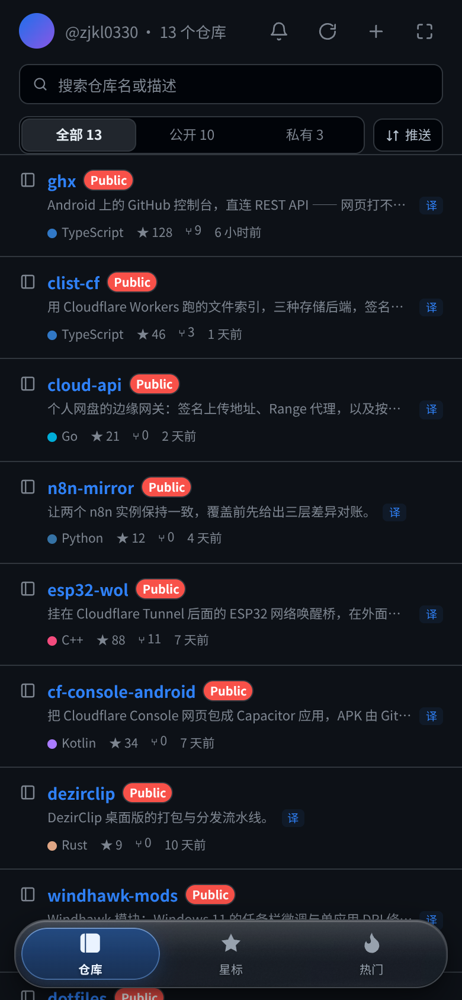
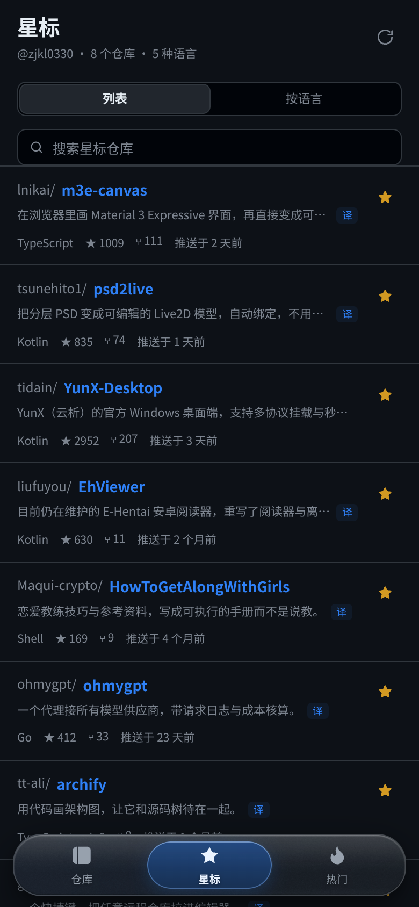
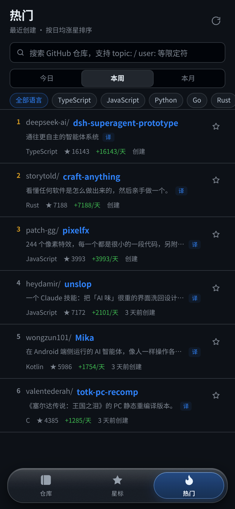
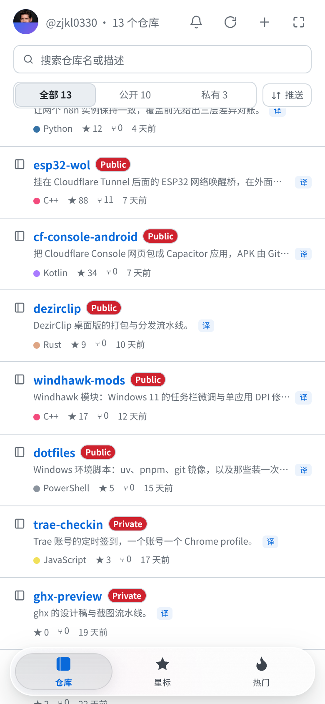
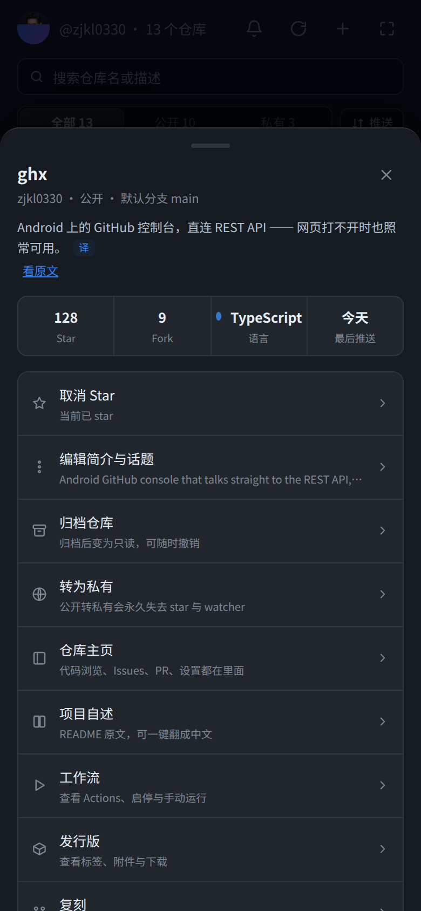
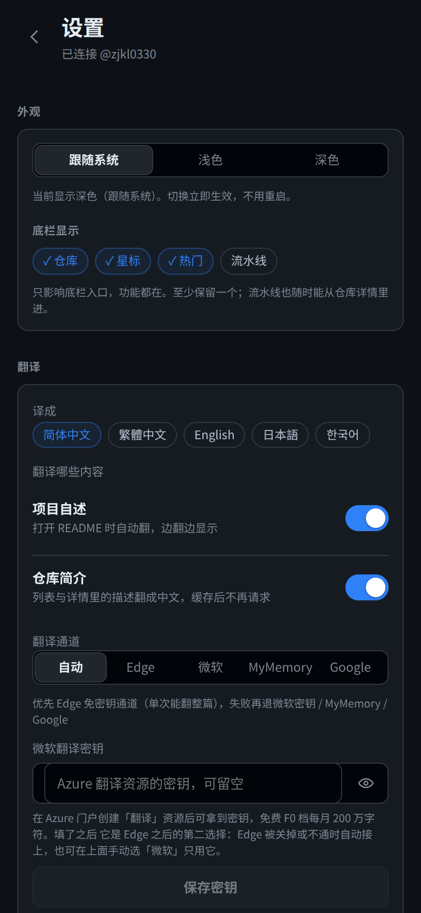
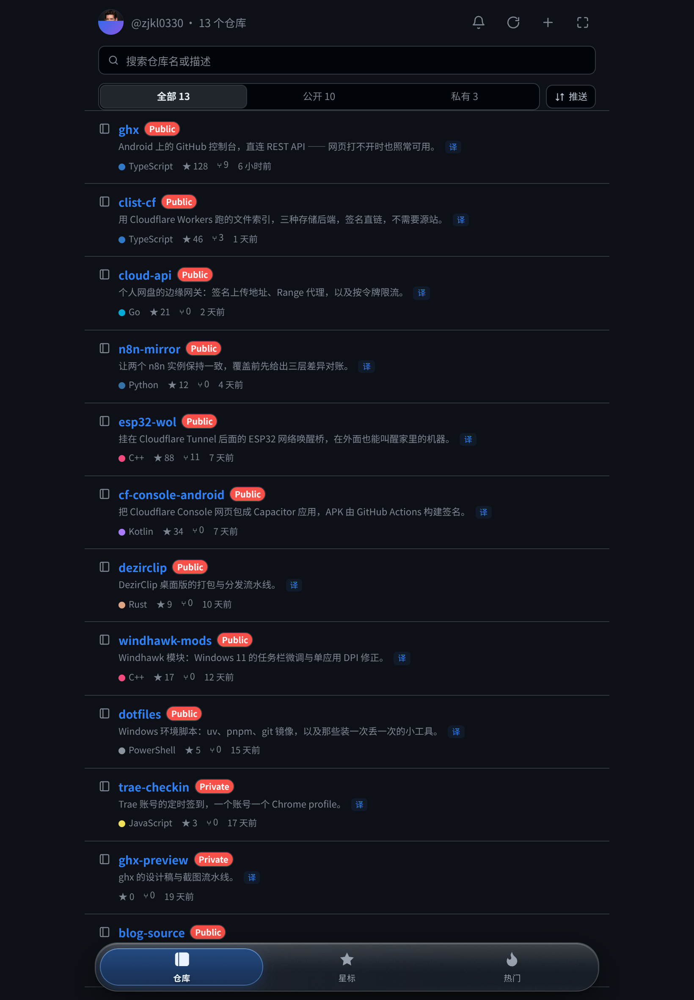
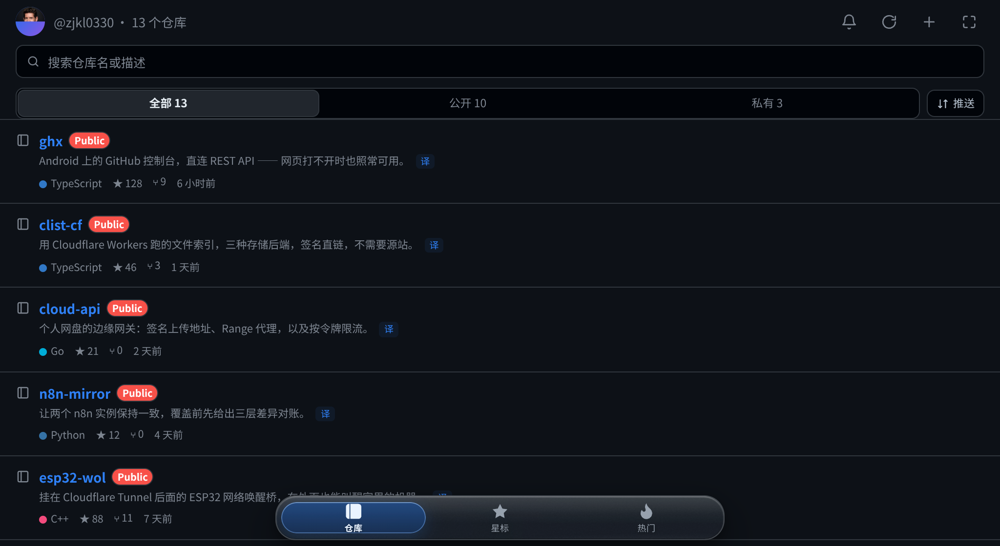

# ghx

Android 上的 GitHub 本地控制台。不给网页版当壳，直接调 REST API，所以 **github.com 打不开的时候它照样能用**。

<p align="center">
  
  
  
</p>

<p align="center"><sub><b>仓库</b>（英文简介自动翻成中文，行尾标「译」）· <b>星标</b> · <b>热门</b></sub></p>

## 为什么有这个东西

国内访问 github.com 网页经常失败，但 `api.github.com` 通常还是通的。网页打不开 → 改不了仓库可见度、管不了令牌。ghx 就是补这个缺口：用一个装在本机的 App，通过 API 完成这些管理动作，不依赖任何后端服务。

## 这一版改了什么（v0.5.8）

| 改动 | 说明 |
|---|---|
| 底栏换成真玻璃 | 上一版是 0.9 不透明的厚板 —— 当时断言 `backdrop-filter` 不执行，其实是截图环境不做模糊。现在底色降到 0.62，让 `blur(64px) saturate(180%)` 把背后正文糊成色团：读不出字，但看得出密度。透光交给模糊，厚度只兜底 |
| 底栏图标改实心 | 22px 实心剪影（书 / 星 / 火 / 播放框），选中只换颜色不换形状。线条图标在玻璃上重量不够，远看只剩一团雾 |
| 横屏不再留白 | 横屏时内容列还被 620px 卡着，左右各空出一百多像素，浅色主题下就是两条白边。现在横屏铺满，底栏反过来收窄到 460px 居中，不拉成一根横杠 |
| 截图流水线修正 | `scripts/shots.py` 换成有头 Chromium（`xvfb-run -a`），不再用 Playwright 默认的 headless shell —— 后者不做 backdrop-filter，玻璃会拍成色块。顺手补了一张浅色主题的底栏特写 |

上一版（v0.5.5）的内容仍在：热门 / 星标也翻简介、应用图标与启动图重绘、检查更新指向 `zjkl0330/ghx`。

## 能做什么

| 能力 | 说明 |
|---|---|
| 令牌保险库 | 点头像进「我的 → 令牌保险库」；多个 PAT 用 AES-256-GCM 加密落盘，明文只在请求瞬间存在内存；默认免密打开即用 |
| 多账号 | 点顶栏账号名（或「我的」顶部卡片）直接切；每个账号的仓库、通知、上下文各自独立，切换会退出当前页面，不会串到另一个账号。新增账号不抢当前会话，首次导入除外 |
| 启动验证（可选） | 想加一道门时再开：口令包裹设备密钥，启动才询问；随时可改口令或关掉 |
| 深色 / 浅色 | 跟随系统或手动指定，切换即时生效并记住，状态栏颜色一起变 |
| 请求缓存 | GET 按数据类型分档缓存，切页签不重复请求；改完自动失效，刷新可强制回源 |
| 返回键 | 逐层退出：弹层 → 子弹层 → 页签首页，只有首页再按两次才退 App |
| 令牌体检 | 校验有效性、读取 scopes、按有效期提前提醒、查看 API 配额 |
| 仓库总览 | 分页拉取全部可访问仓库，按公开/私有筛选，按名称与描述搜索 |
| 编辑仓库信息 | 改简介、主页、话题，中文逗号/顿号都能当分隔符，自动按 GitHub 规则归一化 |
| 新建仓库 | 选私有/公开、填描述、可初始化 README，仓库名按 GitHub 规则即时校验 |
| 批量改可见度 | 多选后一次性转公开或转私有，逐条回执，公开转私有强制二次确认 |
| 排列方式 | 最近推送 / 最近更新 / 最近创建 / Star 最多 / 名称 A→Z，选择记在本机，冷启动沿用 |
| 项目自述 | 读 README：标题、列表、代码块、图片与徽章都能显示；仓库自带中文版就直接显示，没有才机翻，随时切原文；译文语言可选五种 |
| 冷启动快照 | 上次的仓库列表落盘，打开立刻有内容，后台再刷新；弱网不至于空转 |
| 仓库详情 | Star / 取消 Star、归档 / 取消归档、单条改可见度、复制克隆地址、在浏览器打开 |
| 星标 | 单独一页列出所有 star 过的仓库，可搜索、可直接取消 star；支持按语言分类 |
| 热门 | 今日 / 本周 / 本月 + 语言筛选，按日均涨星排序，可一键 star |
| 仓库搜索 | 热门页顶部可直接搜 GitHub 全区仓库，支持 `topic:` / `user:` 等限定符，按最佳匹配 / 最多星 / 最近更新排序 |
| 简介机翻 | 仓库 / 星标 / 热门三个列表与详情页的英文简介自动翻成中文并标「译」，详情可展开原文；只翻可见的前 30 条，设置里可单独关掉 |
| 机翻通道 | 默认走 Edge 免密钥通道（整篇一两次请求翻完），失败自动降级到微软密钥 / MyMemory / Google，可在设置里手动指定 |
| 代码浏览 | 从仓库主页逐级进目录，面包屑可回跳；文件带行号与语言标注，图片直接预览，二进制给提示；可在 App 里新建、编辑、删除单个文件（提交信息自填，乐观锁防覆盖） |
| 提交历史 | 文件级历史与整库历史，点进去看单次提交的说明、增删统计与逐文件 diff |
| Issues | 开启中 / 已关闭 / 全部三段切换，关键词与标签筛选（带计数）；能发评论、关/重开、改标签、指派、锁定对话、新建 Issue |
| Pull Requests | 列表与详情分开对话/更改两段；逐文件折叠 diff，单文件超 400 行自动截断；能批准、要求修改、按 squash/merge/rebase 合并（带 head sha 防错合）、关闭与新建 |
| 分支与标签 | 列出分支（默认分支置顶）与标签，能新建、删除、改名；含 `/` 的分支名照样能改 |
| 通知 | 收件箱按仓库分组，未读/全部切换，可标记已读、标记完成、全部已读；主界面右上角铃铛带未读点，解锁后自动轮询（条件请求，没新数据不耗配额） |
| 全局搜索 | 仓库 / 代码 / Issue / PR / 用户 / 提交 六类，回车或点按钮才发请求，配额提示写在顶部 |
| 用户主页 | 头像、简介、公司、位置、链接、仓库/关注者/正在关注三个数字，一键关注或取关，列出最近 30 个仓库 |
| 仓库设置 | 简介、主页、默认分支、Issues/Projects/Wiki/ Discussions 开关、合并策略、改名（列出影响清单）、转移、协作者、Watch 订阅 |
| 工作流 | 查看仓库的 Actions、启停工作流、按分支手动触发（工作流声明了 `workflow_dispatch.inputs` 时自动生成参数表单）、看运行与作业步骤、取消、全部重跑、只重跑失败作业、单作业重跑、下载解压日志、看与删产物、删运行记录 |
| 发行版 | 列出所有 release 与附件，按加速前缀下载 APK/压缩包；可新建（含存草稿）、编辑说明、发布草稿、删附件、删除发行版（可顺带删 tag） |
| 复刻 | 查看谁复刻了这个仓库，一键复刻到自己账号并跳到自己的那份 |
| 删除仓库 | 需键入仓库名二次确认，要求令牌具备 `delete_repo` |
| 检查更新 | 版本查询走 API；安装包从多个加速站里测速选最快的一台下载，也能直接打开发行版页面 |
| 加速站管理 | 站点域名换了不用等新版本：每个站点可直接改地址，改完全局生效；也能添加自己的站点并测速 |
| 液态玻璃底栏 | 悬浮胶囊，真 `backdrop-filter` 模糊 + 高光 + 亮描边；选中态是内嵌药丸，横屏矮屏自动压扁 |
| 固定签名 | 跨机器与跨版本签名一致，覆盖安装不丢本地数据 |
| 审计日志 | 本地留痕，每次改可见度、令牌操作、删仓库都记一条 |

## 明确做不到的事

**App 内无法创建 PAT。** GitHub 对 classic 与 fine-grained 令牌都没有公开的创建端点，只能去网页 `settings/tokens` 生成后粘贴导入。任何宣称能在 App 里生成令牌的工具，都是在网页里塞表单。

**发行版附件只能在网页上传。** 上传端点是 `uploads.github.com`，它的响应里没有 `Access-Control-Allow-Origin`，预检也过不去：curl 带令牌直传能拿到 201，但 WebView 里的 `fetch` 发得出去、读不回来，原生 `CapacitorHttp` 又不支持二进制请求体（Js 字符串过桥后按 UTF-8 编码，会把 APK 传坏）。所以 App 里只能编辑、发布、删附件，上传给「网页上传附件」的入口。

**通知与 Watch 只对 classic 令牌有效。** fine-grained 令牌调 `/notifications` 与 `/repos/{o}/{r}/subscription` 一律 403，ghx 直接按令牌类型隐藏入口并写清原因，不让人反复撞墙。

**没有 Copilot。** `copilot_internal/v2/token` 对 PAT 返回 404，`api.githubcopilot.com` 直连报 `Personal Access Tokens are not supported`，GitHub Models 也已在 2026-07-30 停服。想在 App 里用大模型只能自带 OpenAI 兼容服务（DeepSeek / 通义 / Kimi / 硅基流动，跨域实测可用），那是下一批的事。

**公开转私有有代价。** 会永久丢失 star 与 watcher，搜索排名也会掉。GitHub 官方在 CLI 里为此专门要求 `--accept-visibility-change-consequences`，ghx 同样强制二次确认。组织仓库如果限制了「仅 owner 可改可见度」，非 owner 调用会返回 422。

## 界面结构

底栏只剩内容入口，默认三项：**仓库 / 星标 / 热门**。设置里可以勾选要不要把「流水线」也放到底栏，至少保留一个。

底栏是一枚悬浮的液态玻璃胶囊，不是贴在屏幕底边的色块。质感靠四层叠出来：0.62 的半透明底色、`backdrop-filter: blur(64px) saturate(180%)` 把背后正文糊成色团、顶部一道从左上散开的镜面高光、外侧一圈 1px 亮描边加一层外投影。选中的格子是一枚内嵌药丸（带自己的高光与描边），图标是 22px 实心剪影，选中只换颜色。

**这条玻璃差点被写死成塑料板**：上一版断言 `backdrop-filter` 在这套页面里不执行 —— 祖先链干净、computed 值正常，但 `blur(0px)` 与 `blur(100px)` 渲染一模一样，于是把底色抬到 0.9 靠厚度兜底。后来发现是截图环境的问题：Playwright 默认的 headless shell 不做 backdrop-filter，换成有头 Chromium 一测，`blur(64px)` 直接把背后正文抹平。所以现在底色降到 0.62，透光交给真模糊；`scripts/shots.py` 也固定用有头浏览器（`xvfb-run -a`）跑，否则截图里的底栏会变成一块没有模糊的色块。

不认这个属性的老 WebView 由 `@supports not` 兜到 0.96 不透明底色 —— 宁可像塑料，也不能让正文透出来。

<p align="center">
  
</p>

<p align="center"><sub>浅色主题，滚到列表中段：底栏底下那行简介被糊成色团，一个字都读不出来</sub></p>

代价写在样式里：底栏脱离文档流，`.app.with-tabs > .page` 必须补 `padding-bottom`，否则最后一行永远压在胶囊下面。

账号相关的东西收进个人页：**点左上角头像**进入「我的」，里面有令牌保险库、设置、审计日志、检查更新与锁定。原来底栏的「令牌」「设置」两个格子已经去掉，底栏不再需要挤六个。

设置页从上到下依次是：外观（主题 + 底栏显示）、翻译（目标语言 / 翻译范围 / 通道 / 微软密钥）、账号与网络（令牌入口 + API 地址）、安全、版本与更新、本机数据。

流水线是二级页面：从仓库详情的「工作流」进，进入后顶部有返回。工作流详情、运行详情仍是叠在它上面的弹层。

仓库详情里除了可见度、归档、删除，还挂着四个入口：

- **工作流** → 打开该仓库的流水线二级页
- **发行版** → 列出 tag、附件、下载次数，可新建与删除
- **复刻** → 列出全部复刻，可复刻到自己账号
- **项目自述** → 读 README，Markdown 排版，英文可一键机翻

<p align="center">
  
  
</p>

<p align="center"><sub>左：仓库详情（简介译文 + 「看原文」）· 右：设置里的翻译通道</sub></p>

### 多账号

一个 PAT 对应一个 GitHub 账号，保险库可以同时放多个。

- **入口**：顶栏 `@账号名` 右侧的箭头，或「我的」顶部账号卡片；两处都打开同一个面板
- **切换时**：路由栈、仓库列表、未读计数、搜索词、多选态一起归零，再从当前账号的本地快照恢复首屏 —— 不这么做会停在别人的 Issue 详情上，轻则 404 重则看到不该看的内容
- **新增账号**：已有账号在用时不抢占会话，只在后台把 `@login` 补上；第一个账号才自动激活
- **缓存隔离**：每个 `GitHubClient` 自带一份响应缓存，切账号就是换实例，天然不串
- **审计**：每次切换记一条「切换账号」，带着 `@login`

### 多设备

一套布局吃三种宽度，不写第二套 UI：

| 宽度 | 行为 |
|---|---|
| ≤ 639px | 满宽，手机默认形态 |
| ≥ 640px | 内容 620px 居中，平板不再把列表拉成横幅 |
| ≥ 1024px | 760px 居中，横屏平板与桌面预览用 |
| 横屏且高 ≤ 620px | 铺满，不再居中 —— 横屏再留边就是两条白带 |

弹层跟随同一宽度居中；上下左右都吃 `safe-area-inset`；横屏高度不足 620px 时内容铺满、底栏压到 46px 并收窄到 460px 居中、圆角收小。**锁定双指缩放**：整页放大后底栏的模糊采样跟着放大，正文会从玻璃里透出来；想放大字号请用系统的「字体大小」，WebView 的 `textZoom` 照常跟随。

<p align="center">
  
  
</p>

<p align="center"><sub>左：平板 820×1180 按列居中 · 右：横屏 1024×560 铺满，两侧不留白 —— 底栏在平板上跟着收窄，横屏反过来收到 460px，不拉成一根横杠</sub></p>

## 返回键

安卓的返回键一按就退 App，是因为没人接管，系统直接 `finish()` 掉 Activity。ghx 把返回做成逐层退出：

| 当前状态 | 按返回 |
|---|---|
| 软键盘弹着 | 先收键盘 |
| 口令面板 | 关面板，留在设置页 |
| 发行版 / 复刻 / 项目自述 | 回仓库详情，而不是整屏收起 |
| 运行详情 | 回工作流详情（从流水线直接进来的则收起） |
| 运行日志 | 回运行详情 |
| 提交详情 | 回提交历史，再退一层回文件 |
| 任意弹层 | 关掉最上面一层 |
| 二级页面（个人页 / 设置 / 令牌 / 审计 / 流水线） | 退回上一层：设置回个人页，个人页回主界面 |
| 批量多选 | 退出多选，保留筛选条件 |
| 非首页页签 | 回底栏第一项 |
| 仓库页 | 第一次提示「再按一次返回退出」，2 秒内再按才退 |

批量改可见度正在执行时返回会被拦下，和界面上禁用取消按钮保持一致，避免任务跑到一半看不见结果。

## 缓存

切页签、退弹层再进，默认不再重新打网络。缓存按数据类型分档，改完自动失效：

| 数据 | 缓存时长 | 为什么 |
|---|---|---|
| 搜索结果（热门） | 5 分钟 | 搜索接口配额最贵（认证后 30 次/分钟）|
| 星标 / 仓库列表 | 60 秒 | 变化不频繁，切页签够用 |
| 运行列表 | 15 秒 | 状态变化快 |
| 作业与步骤 | 20 秒 | 同上 |
| 发行版 / 复刻 | 2 分钟 | 基本静态 |

内存缓存随进程消失，所以仓库列表另外落一份快照到本机：冷启动先渲染上次的数据，同时后台刷新，界面不再空转。快照带令牌 id，换号不会串数据，超过 7 天自动作废。

## 自述阅读

打开 README 时按这个顺序取内容：

1. **仓库自带中文版** —— README 顶部有「English | 简体中文」这类语言切换（文字链接、图片按钮都认），或者目录里存在 `README.zh-CN.md` / `README.zh.md` / `README_CN.md` 这类命名，直接显示作者自己的译文，不机翻、不消耗额度。
2. **原文就是中文** —— 直接显示。
3. **机翻** —— 只有前两条都不成立才翻，设置 → 阅读里可整体关掉。

图片与徽章按原样渲染：相对路径会按 README 所在目录解析到 `raw.githubusercontent.com`，``、`<picture>`、`` 都支持；同一行的多张图（语言按钮、徽章墙）并排排布，不各占一行。

图片默认走加速站（路径风格为 `{前缀}/{owner}/{repo}/raw/{branch}/{path}`，完整地址风格为 `{前缀}/https://raw.githubusercontent.com/...`），失败或 12 秒无响应再回退直连，两边都不通才显示「图片没能加载」占位。国内直连 raw 域名经常连不上，`` 在等待时又不触发错误回调，不设超时就是一块永远空白的区域。

翻译走免费通道，没有自己的后端：

| 通道 | 情况 |
|---|---|
| Edge（默认首选） | 微软 Edge 浏览器自带的翻译接口，**免密钥、不用注册**，国内实测可直连；单次能吞 5 万字符，整篇 README 一两次请求就能翻完，简介还能 40 条一批。它不是公开 API，微软随时可能关掉，所以只作默认、不作唯一：关掉了自动降级到下面几条 |
| 微软（Azure Translator） | 官方接口最稳。需要自己在 Azure 建一个「翻译」资源（免费 F0 档每月 200 万字符），把密钥填进设置；单次 4 千字节，简介可 25 条一批 |
| MyMemory | 不用密钥，国内可达，但单段 450 字节，撞 429 会退让重试；免费额度有限，适合偶尔翻一两篇 |
| Google | 质量不错，国内常连不上，只作备选 |

「自动」模式的顺序是 **Edge → 微软（填了密钥）→ MyMemory → Google**，前一条失败才走下一条，不会因为一家挂掉就整篇留在英文。

> 2026-07-30 微软关掉了老的 `edge.microsoft.com/translate/auth` 取 token 接口（现在固定 404），App 已改用新的 `translatetext` 端点。这类免费接口没有 SLA，所以设置里随时可以手动切通道。

**译文语言**可选简体中文 / 繁體中文 / English / 日本語 / 한국어，选择记在本机。

**翻译范围**在设置里分开控制：项目自述、仓库简介。自述打开时自动翻、边翻边显示；简介只翻当前列表可见的前 30 条（批量通道一次 30 条、逐条通道压到 12 条）与正在看的详情，命中缓存后不再请求。仓库 / 星标 / 热门三个列表共用这条规则，取数逻辑只有 `pickDescItems()` 一处。

原文按段落切分，一次最多翻 40 段、并发 6（MyMemory 这类要限流的通道降到 20 段、并发 3），翻好一段就替换一段。长 README 翻完一批可点「继续翻译剩余 N 段」。

两处历史 bug 已修：

- **长段落整块发出去被 MyMemory 拒绝**，超过 450 字节的引用块、长段落一直显示英文。现在块内先按通道上限切分，逐段翻完再按原顺序拼回，单段失败只留那一段原文。
- **中英混排被误判成「已是中文」**：旧逻辑按中文占比 15% 就跳过，一句中文夹一串英文术语就会漏。现在改成 `needsTranslation()`，按非目标语言字符占比判断。

代码块不送翻。译文按「通道 + 目标语言 + 内容哈希」存在本机，同一份内容只消耗一次额度。

写操作（改可见度、star、触发工作流、发版）成功后，只清掉受影响的那部分缓存。刷新按钮与后台轮询一律绕过缓存，避免「点了刷新还是旧数据」。

## 权限要求

| 功能 | 需要的 scope |
|---|---|
| 读仓库 / 改可见度 / 归档 | `repo`（私有仓库）或 `public_repo` |
| 工作流启停、手动触发、取消与重跑 | `workflow` |
| 删除仓库 | `delete_repo` |
| 新建 / 删除发行版 | `repo` |

缺 scope 时 App 会直接显示「权限不足：该令牌没有执行此操作的 scope」，不会静默失败。手动触发还要求工作流自身声明了 `workflow_dispatch`，否则 GitHub 返回 422，App 会说明原因。

## 安装

从 [Releases](https://github.com/zjkl0330/ghx/releases) 下载 `ghx-<版本>-debug.apk` 直接安装。要求 Android 6.0+（minSdk 23）。

打开即用，不设口令、不弹解锁页。要加锁的话去「设置 → 安全 → 开启启动验证」，口令至少 8 位，忘了无法找回。

## 检查更新怎么走

两条通道刻意分开：

- **查版本** → `api.github.com/repos/zjkl0330/ghx/releases/latest`，匿名请求，不带你的令牌
- **下安装包** → 加速站（默认自建 `gh.zjkl0330.dpdns.org`），因为 github.com 的下载直连基本不通

加速站内置了一组候选（自建、gh-proxy.com、ghfast.top、ghproxy.net、ghproxy.imciel.com、gitproxy.click、官方直连）。进「设置 → 下载加速」会逐个测速：每个站只拉前 256 KB，按实际吞吐排名，**默认自动选最快的一台**并用于安装包与自述图片。测速结果缓存 6 小时，冷启动不会重测；换了网络想重测，点一下「重新测速」即可。

**加速站域名会换，所以每个站点都能改地址。** 列表里点站点右侧的铅笔，直接改前缀，保存后立即全局生效 —— 自述图片、安装包下载、发行版页面用的是同一份站点表，不用等新版本。改错了有「恢复默认」；也能「添加自己的站点」，填地址、选路径风格、勾选是否代理网页，加进来就能一起测速。

代理有两种路径风格，填错会 404，App 里按站点类型自动拼：

| 风格 | 拼出来的下载地址 |
| --- | --- |
| 路径 | `{前缀}/{owner}/{repo}/releases/download/{tag}/{文件}` |
| 完整地址 | `{前缀}/https://github.com/{owner}/{repo}/releases/download/{tag}/{文件}` |

更新页还有「打开发行版页面」：查不到更新、或安装包没上传完时，可以直接在浏览器里看说明、手动下载。纯下载型代理不代理 HTML，这类站点上该按钮会退回自建站点，不会点出一片 403。

更新时用系统浏览器下载，装完覆盖安装，本地令牌与审计日志不会丢。

## 本地构建

```bash
pnpm install
pnpm test                 # 584 项单元测试
pnpm build                # 类型检查 + 打包
pnpm cap:sync             # 同步版本号到 gradle 并 cap sync

cd android && ./gradlew assembleDebug
```

产物在 `android/app/build/outputs/apk/debug/app-debug.apk`。

需要 JDK 21（Capacitor 7 的硬要求）与 Android SDK 35。

版本号只在 `package.json` 维护一处，`scripts/sync-version.mjs` 会把它同步成 gradle 的 `versionName` 与 `versionCode`（`major*10000 + minor*100 + patch`）。

CI 在 `.github/workflows/build-apk.yml`：push 到 main 出 artifact，打 `v*` tag 自动发 Release 并附 APK。

## 版本与发布

每改一次就推进一个补丁位，补丁位满 10 进次版本，每次推进都直接发 Release：

| 当前 | 下一次 | 说明 |
|---|---|---|
| 0.4.0 | 0.4.1 | 补丁位 +1 |
| 0.4.8 | 0.4.9 | 补丁位到 9 |
| 0.4.9 | 0.5.0 | 补丁位满 10，进位归零 |
| 0.9.9 | 1.0.0 | 次版本同样满 10 进主版本 |

```bash
pnpm version:bump                                   # +0.0.1，同时同步 gradle
pnpm test && pnpm build
git add -A && git commit -m "feat: ..."
git tag -a "v$(node -p "require('./package.json').version")" -m "ghx $(node -p "require('./package.json').version")"
git push origin main --tags
```

tag 一推，CI 自动构建 APK、校验签名指纹（不匹配直接失败）、生成 Release 并附安装包。

## 解锁方式与安全边界

密钥和口令是两件事，ghx 把它们拆开了：

| 模式 | 启动体验 | 适用 |
|---|---|---|
| 免密（默认） | 打开直接进主界面 | 一个人用的手机 |
| 启动验证（可选） | 每次启动输口令 | 手机可能被别人拿去 |

两种模式令牌都是 AES-256-GCM 密文落盘。区别只在设备密钥放在哪：免密时它也留在本机，所以能防住「数据文件被单独拷走或上传」，防不住拿到已解锁手机的人；开启启动验证后，设备密钥被口令包裹，才真正需要口令才能解开。

- 旧版本（口令派生密钥）的保险库会在解锁屏或设置页提供一次性迁移，令牌解密后重新加密，原文不变
- 口令只在本机参与解密，不上传、不保存，也没有找回途径
- 没有后端、没有遥测、没有账号体系，所有请求从手机直发你配置的 API 地址
- 手动「锁定保险库」会清空内存中的密钥与明文；免密模式下再点一下就回来，只起遮挡作用
- 审计日志只存本机，可一键清空
- 仓库 URL 一律用 `owner/name` 拼接，不做文件系统操作

## 项目守则

历次需求与踩坑记录整理在 [RULES.md](./RULES.md)：交付形态、界面基调、令牌与解锁、返回键层级、缓存策略、版本与发布流程、验证标准、已知边界。改动前先读。

接手写代码（人或 AI）先读 [AGENTS.md](./AGENTS.md)：目录地图、五个核心机制、硬约束、踩过的坑、发布流程。**读完这一份不用再通读源码**。
接下来要做什么、哪些功能做不了、为什么，见 [ROADMAP.md](./ROADMAP.md)：按 Issues / PR / 代码浏览 / 分支 / Actions / 通知 / 搜索分批，每项都标了 REST 端点、所需 scope、复杂度和坑。

## 许可

MIT
