# ghx

Android 上的 GitHub 本地控制台。不给网页版当壳，直接调 REST API，所以 **github.com 打不开的时候它照样能用**。

<p align="center">
  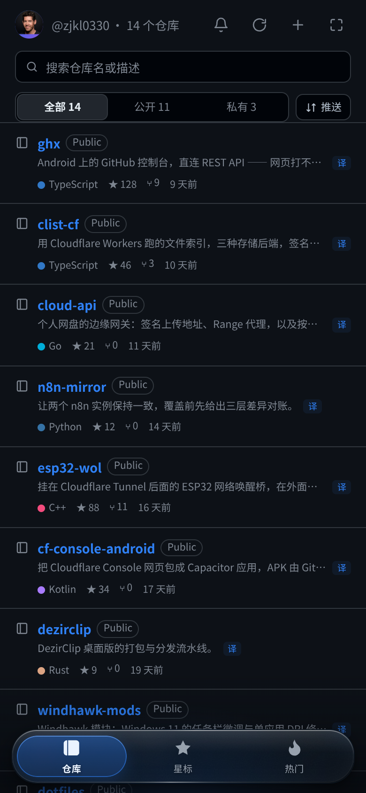
  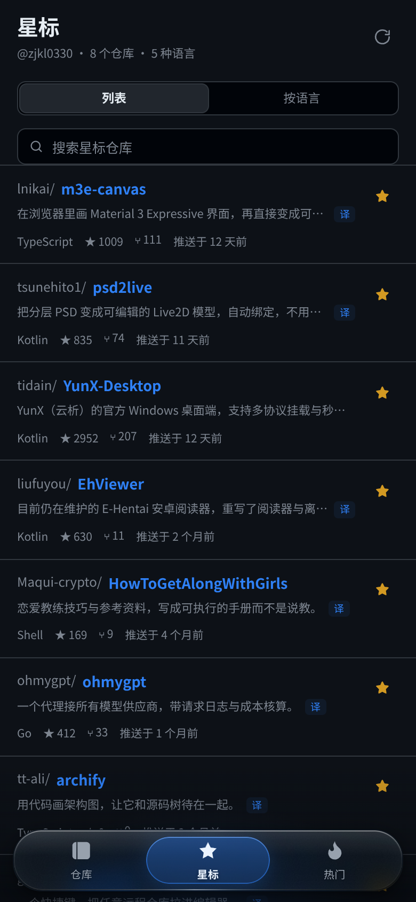
  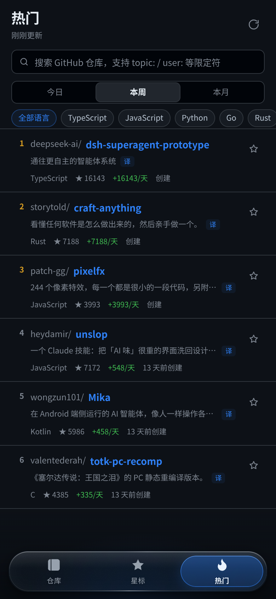
</p>

<p align="center"><sub><b>仓库</b>（英文简介自动翻成中文，行尾标「译」）· <b>星标</b> · <b>热门</b></sub></p>

## 为什么有这个东西

国内访问 github.com 网页经常失败，但 `api.github.com` 通常还是通的。网页打不开 → 改不了仓库可见度、管不了令牌。ghx 就是补这个缺口：用一个装在本机的 App，通过 API 完成这些管理动作，不依赖任何后端服务。

## 这一版改了什么（v1.2.1）

**补两个「一直空着」的地方：私有仓库的图，和 Issue/PR 的历史痕迹。**

| 改动 | 说明 |
|---|---|
| 私有仓库的图能看了 | `raw.githubusercontent.com` 对匿名请求直接回 404（预检还回 403），而 `` 带不了 `Authorization`。现在图片加载失败或 4 秒没出来时，改走 API `contents` 带令牌取字节、换成 `blob:` 地址；公开图仍走原来的镜像通道，不多一次请求 |
| 一处覆盖四个板块 | 自述、Issue 正文、PR 正文、发行版说明里的图共用 `MdImage`，所以四个地方一起修好 |
| Issue 详情有「动态」了 | 之前只显示评论，标签谁加的、什么时候关的完全没有痕迹。现在把 timeline 事件译成一行人话（加/移标签、指派、关闭原因、改名、跨仓库引用、合并），默认给最近 8 条，可展开 |
| PR 对话区补齐 | PR 详情原来只有描述、提交、审核，普通评论根本不显示。现在补上评论列表与评论框，并在其上加同一份「动态」 |

已知代价：动态只覆盖 REST 能给的字段，GraphQL 独有的（例如草稿状态的完整流转）看不到；跨仓库引用只显示 `owner/repo#号`，不提供跳转。

## 上一版（v1.2.0）

**把底栏玻璃「溢出圆角」的那片模糊收回去，并把整个功能面重新点了一遍。** 这一版没有新功能，
只处理两件被看见的问题，然后从预发布转正。

| 改动 | 说明 |
|---|---|
| 模糊只发生在胶囊里 | 玻璃背后那层压暗 + 模糊原本是「整屏宽 × 132px」的矩形，圆角之外（左右各 12px、胶囊上方 64px）照样在糊正文，看上去是「一个模糊的方框里放着一枚胶囊」。现在它与胶囊同 inset、同高、同半径，悬浮态还去掉了自己那遍模糊 —— 圆角以外恢复清晰 |
| 压暗层与胶囊共用变量 | `--tabbar-h` / `--tabbar-radius` / `--tabbar-gap` / `--tabbar-inset` 一处定义，底栏、压暗层、横屏矮屏三处读同一组值，不会再出现「改了胶囊忘了背后那层」 |
| 商店清单写死单列 | 卡片加 `width: 100%`，不依赖父级 `flex-direction`。v1.1.0 的商店是两列网格，v1.1.2 起改成了单列清单；这条兜底让最老的 WebView 也排不出两列 |
| 功能面盘点 | 新增 `scripts/verify-features.py`：**77 项入口断言**，把 README「能做什么」逐条落到界面上的可见控件（底栏 / 仓库页 / 批量 / 我的 / 设置 / 热门 / 商店 / 星标 / 详情 / 全局搜索 / 通知 / 看板 / Gist），少一个就报名字 |

文档订正：`界面结构` 里「打开仓库 → 在系统浏览器里打开」已经不成立 —— v1.1.0 起 GitHub 链接
一律站内打开，详情页给的是「仓库主页」与「复制仓库地址」，要网页版就复制出去自己粘。

## 上一版（v1.1.12）

**升级不再丢加速站。** v1.1.3 把内置加速站表从包里拿掉后，只迁移了「改过地址」
的那部分配置 —— 但**绝大多数用户的默认站从来没落过盘**（老版本的加速站是写在安装包里的常量），
所以他们一升级，站点表就整个空了。这一版把这件事补上。

| 改动 | 说明 |
|---|---|
| 从本机记录里认回旧地址 | 读 `ghx.mirror`（当时选中的站）和 `ghx.mirror.speed`（上次测速快照里的地址），补成自定义站 |
| 只接一次 | 迁移后写 `ghx.mirror.restored`，用户手动删掉的站不会被下次启动又补回来 |
| 风格未知时两种拼法 | 继承来的地址只有域名、没有路径风格记录，候选里同时给 `{base}/{path}` 与 `{base}/https://github.com/{path}`，测速失败还会再试一次 |
| 新装保持零预置 | 两个键都不存在 → 站点表仍然只有官方直连，包里一个加速站地址都没有 |

## 上一版（v1.1.11）

**清理排查期间插进去的调试界面。** 病根（下载中枢的空指针）在 v1.1.10 修掉了，
那些用来「把原因摊到屏幕上」的东西就该退场 —— 它们会挡住正常界面，不该出现在发行版里。

| 移除了什么 | 原来做什么 |
|---|---|
| 「上次 App 是这么退出的」整屏面板 | 显示系统账本、崩溃栈、启动流水账 |
| 页面内联取证脚本（`__ghxTrace`） | 逐段盖时间戳、8 秒没挂载就把轨迹印在遮罩上 |
| 原生启动探针（4 秒 / 12 秒查 `#root`） | 判断「脚本到底跑没跑起来」 |
| JS 线程 6 秒探活、8 秒白屏自检 | 死循环与空白的兜底提示 |
| React 错误边界整屏堆栈页 | 挂载失败时把堆栈画到屏幕上 |
| 启动阶段流水账 `boot-stage.txt` | 记录死在哪一步 |

保留了两样**用户看不见**的东西：进程级崩溃落盘（`crash.txt`），以及启动真的走不下去时
一句 Toast + 对话框 —— 这两个是正常的错误处理，不是调试面板。

## 上一版（v1.1.10）

**「打开就闪退」的真正原因找到了，是下载模块里的一个空指针。** 前几版查旧 WebView、
查语法等级、查渲染进程，全都被症状带偏了；真正的证据是系统崩溃记录里那一行：

```
java.lang.RuntimeException: java.lang.reflect.InvocationTargetException
  at com.getcapacitor.Bridge$1.run(Bridge.java:859)
Caused by: java.lang.NullPointerException: Attempt to invoke virtual method
  'java.io.File android.content.Context.getExternalFilesDir(java.lang.String)'
  on a null object reference
  at dev.zjkl.ghx.DownloadHub.downloadDir(DownloadHub.java)
```

链路是这样的：`DownloadHub` 的静态 `Context` **只在 `start()` 里赋值**，
而冷启动时页面第一件事就是调 `status()` 对账：

```
status() → snapshot() → partOf() → downloadDir() → app.getExternalFilesDir(...)  ← app 是 null
```

异常抛在 Capacitor 的插件线程上，没人接，进程当场被杀 —— 于是开屏动画放完就「闪退」，
而且什么日志都不留。这正好解释了为什么 **v1.1.0 正常、v1.1.2 开始必崩**：下载功能是 v1.1.2 加的。

| 改动 | 说明 |
|---|---|
| **Context 提前装上** | `Application.onCreate` 与插件 `load()` 里都调 `DownloadHub.install(...)` |
| **`downloadDir()` 判空** | 取不到 Context 就返回 null，不再直接打在静态字段上 |
| **`snapshot()` 断点查询兜底** | 目录没准备好就当「没有断点」，绝不外抛 |
| **插件方法不再外抛** | `status` / `takePending` / `exists` 一律就地转成 JS 侧错误 —— 插件线程上抛异常等于整进程自杀 |
| **红线脚本** | `scripts/check-npe-guards.py`：把「先装 Context、用到的地方判空、插件方法不外抛」写成可执行断言 |

## 上一版（v1.1.9）

上一版屏幕上留下的一句话推翻了我之前的全部判断：`原因：4`、`系统描述：crash`。
`4` 是 Android 的 `REASON_CRASH` —— **进程里有未捕获的 Java 异常**，不是被 OEM 杀掉。
（前一版把原因码表整体写错了两格，把「崩溃」报成了「被系统杀死」，这次先修表。）

既然是 Java 崩溃，系统就留着崩溃栈，只是上一版没去取：

| 改动 | 说明 |
|---|---|
| **取出系统留存的崩溃栈** | `ApplicationExitInfo.getTraceInputStream()` 对 CRASH / CRASH_NATIVE / ANR 会保留现场，这是唯一能在进程已死之后拿到堆栈的通道 |
| **处理器提前到 Application** | 以前装在 `MainActivity.onCreate`，漏掉「Activity 类本身加载失败」这一段。改到 `attachBaseContext`，比任何 Activity 都早 |
| **崩溃记录单独一个文件** | 以前崩溃栈和普通日志共用 `boot-failure.txt`，启动早期一条 note 就把它覆盖了；现在崩溃写 `crash.txt`，永不与日志互相覆盖 |
| **启动阶段流水账** | 每一步写一行带毫秒的时间戳到 `boot-stage.txt`，崩溃后能看出死在哪一步 |
| **延迟任务全部兜住** | 主线程上 post 出去的 Runnable 抛异常会直接杀进程，且没有任何提示。insets 四次补推等全部套了保护，抛错只记账 |
| **三份证据合成一屏** | 系统账本（含崩溃栈）+ 本机崩溃记录 + 阶段流水账，缺哪份就少显示哪块 |

## 上一版（v1.1.6）

这一版不猜原因，只做一件事：**让启动过程自己说话**。上次的兜底只管「抛异常」，
而「先亮后黑」这种死法一条异常都不抛，所以它什么都没抓到。

| 改动 | 说明 |
|---|---|
| **启动逐段盖时间戳** | `html → imports → render → commit → ready`，记在 `window.__ghxTrace`。停在哪一段，就是哪一层的问题：停在 `html` 是包没跑起来，停在 `commit` 之后是挂载完才崩的 |
| **失败不再变成黑屏** | 撤遮罩前先确认真的就绪；6 秒起每 3 秒盯一次 `#root`，空了就把轨迹印在屏幕上。遮罩已经撤掉的（先亮后黑）会自己造一层底再印，不会再留给用户一块纯黑 |
| **一眼分清两大家族** | 有 `commit` → 「React 已卸载（挂载后崩溃）」；没有 → 「React 未挂载（包没跑起来）」。这两句话指向完全不同的修法 |
| **原生探针加了第二次检查** | 4 秒查一次不够：4 秒时还是好的、6 秒后树被卸载，正好漏掉。现在 12 秒再查一次，面板里直接带上前端轨迹 |
| **顺手拆掉一个同类隐患** | 翻译里有 `/\\p{Extended_Pictographic}/` 字面量。老内核的 Unicode 数据没有这个属性时，**字面量在解析期就抛错、整包报废**。改成运行时 `new RegExp` + 兜底，最坏只是那条判断失效 |

## 上一版（v1.1.5）

这一版只做一件事：**把「打开就闪退」修掉，并且保证下次再出问题你能看见原因。**

| 改动 | 说明 |
|---|---|
| **不再依赖 `crypto.randomUUID`** | 它是 Chrome 92 才有的，而这条调用正好在「解锁后写一条审计」上 —— 每次启动必经。老系统 WebView（国产 ROM 常年停在 60~90）在那里直接抛 `TypeError`，页面就停在启动图后面。现在改用 `getRandomValues` 自己拼 v4，Chrome 11 往上都能跑 |
| **构建目标从 ES2020 降到 ES2017** | 之前产物里留着 `?.` 与 `??`，那需要 Chrome 80；一旦内核不认，整个 bundle 一行都不执行。降级后 Chrome 55 就能解析，代价只有几 KB |
| **启动期错误必须上屏** | 加了错误边界 + 内联兜底：任何启动异常都会在屏幕上摊出堆栈，同时把摘要写进 `document.title`。原生侧 4 秒后探针检查 `#root` 是否真有节点，两条信号都不对就弹原生面板，一并带上 WebView 版本、Android 版本、机型和可用存储 |
| **探针不再只认「进度 0」** | 之前的 8 秒自检只看加载进度，而这类故障的进度是 100%（资源都下来了，只是脚本没跑起来）。现在改成直接问页面「你渲染出来了吗」 |

更早（v1.1.3）：包里不再预置任何加速站地址，装完默认走官方直连，要加速自己在面板里填一次；升级时老配置原样搬过来，已装好的机器不受影响。

## 这一版改了什么（v1.1.3）

| 改动 | 说明 |
|---|---|
| **包里不再带任何加速站地址** | 以前安装包里预置了自建反代和几家公共代理，装完就默认走它们 —— 等于把作者那台服务器的带宽摊给所有人。这一版把预置表清空，**默认线路就是官方直连**，要加速自己在「加速站」面板里填一次，存在本机，换包不丢 |
| **已经装好的机器不受影响** | 升级时会把老配置搬过来：改过地址的内置站转成自定义站（路径风格原样保留），当前选中的站继续生效，用户自己加的站一条不动。只是不再给新设备填默认值 |
| **没填站时的表现** | 下载候选只剩「官方直连」一条；测速面板只有一行；能翻页的兜底直接回 github.com。不会去连任何你没配过的域名 |
| **旧地址仍然认得出来** | 从旧版本继承来的站没有风格记录，下载时同时给 path 与整段 URL 两种拼法，让探活自己挑 —— 猜错风格不该等于下不动 |

上一版（v1.1.2）的内容仍在：分片下载最高 32 路、断点续传、后台下载与进度横幅、行内星标可直接点、Star / 复刻按偏好预勾账号。

更早（v1.1.1）：机翻不再顶掉链接（拆片段送翻，地址全程不出本机）、APK 商店两列改单列、每个账号的现场落盘。

更早（v0.8.9）：测速改 3 条并发（六条线路从「和」变「约三分之一」）、结果按站点存一天只测一次、换包不再串数据。

上一版（v0.8.8）的内容仍在：熄屏 / 切后台不再中断下载 —— 线程搬进进程级单例，加 `PARTIAL_WAKE_LOCK` + `WifiLock` + **前台服务**（Android 12+ 的 Cached Apps Freezer 只认这个），通知栏带进度，页面被回收后能对账；设置 → 本机数据 →「下载记录」可回看并跳回仓库。

上一版（v0.8.7）的内容仍在：界面字体可选，默认内置 OPPO Sans 4.0（22.7 MB 原始 TTF，不做子集化 —— 许可禁止修改字体），设置里可切回系统字体。

上一版（v0.8.6）的内容仍在：长简介改块级裁剪，华为上不再顶出屏幕 —— 不再依赖 flex 的 `min-width: 0`（老内核不认，实测同一条件下旧写法被撑到 2018px）。「译」标改绝对定位钉在行尾，极长仓库名与行本身都加了收缩兜底。

上一版（v0.8.5）的内容仍在：「复制仓库地址」改走三条通道（原生剪贴板 → `navigator.clipboard` → `execCommand`），华为 WebView 上不再抛英文错误；三条全挂时摊开可长按的地址。

上一版（v0.8.4）的内容仍在：一页 25 个仓库的 `APK`/`EXE` 标记合并成 **1 次 GraphQL 调用**（1 点、0.77 秒，走 GraphQL 自己的配额池，REST 一个点都不动），空结果也缓存 24 小时，批量不通时只把这一批退回逐条，单个别名出错不牵连整批。

上一版（v0.8.3）的内容仍在：下载线路补到 6 条（自建 + 四个能吃发行版资产的代理 + 官方兜底），官方直连改按档位排在最后（探针只测前 256 KB，测不出它后段掉速），仓库行 `Public` 旁标出 `APK` / `EXE`。

上一版（v0.8.2）的内容仍在：高透液态玻璃底栏 —— 底色白色低透明度、模糊锁在 10–16px、朝内容一侧的渐变遮罩、图标与文字加投影。

上一版（v0.8.1）的内容仍在：无令牌也能看热门（游客只读、走匿名配额、star 收起）。

上一版（v0.8.0）的内容仍在：剪贴板直达（复制 `github.com/a/b` 切回 App 就落在那个仓库，冷启动也认；issue、PR、代码目录、提交、个人主页、`git@` 都认；只留指纹不留原文，令牌类内容不碰；设置里可关）。

上一版（v0.7.9）的内容仍在：自述链接可点、表格内链接与行内代码、`#锚点` 跳转、正文加深 20%、Issue/PR 翻页、星标去掉 150 上限、CI 产物下载。

上一版（v0.7.8）的内容仍在：应用内下载安装包、三类下载合并成同一张线路表、逐条测速、失败自动换线、源码 ZIP 去重。

上一版（v0.7.7）的内容仍在：多账号同时 Star / 同时复刻、逐条回执、账号归属探测修复。

上一版（v0.7.6）的内容仍在：多账号并行工作区、客户端实例复用、过期响应丢弃。

上一版（v0.7.5）的内容仍在：通知直读、搜索命中高亮、批量操作扩展。

上一版（v0.7.4）的内容仍在：提交历史翻页、自述目录、仓库置顶。

上一版（v0.7.3）的内容仍在：Issue/PR 高级筛选、贡献日历、里程碑。

再往前（v0.7.2）：Gist、Issue 模板、仓库内搜索。

更早的内容仍在：热门三层缓存与预取、浅色底栏真正透出背后内容、复制仓库地址、拼音简介不再被音译、启动画面三段接力、外观六组选项、全屏铺满与沉浸式开关。

## AI 这一块先给计划，不动手

怎么让 AI 干活又不让它碰到令牌，方案写在 [`docs/ai-plan.md`](docs/ai-plan.md)。要点：

- **默认走本地执行器**：AI 只输出「动作」（封闭枚举），客户端校验、确认、用自己的令牌执行。令牌一步都不离开设备。
- **你说的「环境变量代理」可行，但只在 Worker 里成立**：Worker 的 secret 不是给 AI 读的，AI 只看到工具定义。真正的风险是工具做得太宽 —— 暴露一个 `gh_api(method, path, body)` 的万能代理，等于把令牌整个交出去。所以工具必须是有语义的白名单。
- **代价要说清**：那条路把令牌从本机搬到了 Cloudflare，与「令牌只存本机」的承诺冲突，所以只能是默认关闭的高级选项。
- 破坏性动作（删仓库、改可见度、force push、合并 PR）**不放进动作枚举**，AI 提都提不出来。

## 能做什么

| 能力 | 说明 |
|---|---|
| 令牌保险库 | 点头像进「我的 → 令牌保险库」；多个 PAT 用 AES-256-GCM 加密落盘，明文只在请求瞬间存在内存；默认免密打开即用 |
| 多账号 | 点顶栏账号名（或「我的」顶部卡片）直接切。**每个账号一套独立工作区**：路由栈、列表、搜索词、筛选、排序、未读、置顶都各自记着，切走再切回来接着看，重启也在；客户端实例复用，切回不重新拉网络。新增账号不抢当前会话，首次导入除外 |
| 启动验证（可选） | 想加一道门时再开：口令包裹设备密钥，启动才询问；随时可改口令或关掉 |
| 深色 / 浅色 | 跟随系统或手动指定，切换即时生效并记住，状态栏图标明暗一起变 |
| 外观自定义 | 强调色六选一、底栏悬浮或通栏、底栏文字可只留图标、背景氛围光、玻璃三档（浅色下真正透出背后内容）、动效两档；全部即时生效并记住 |
| 启动画面 | 系统启动屏 → 首屏遮罩 → 页面三段接力，深浅色各一套底色；精简动效下不做缩放与滑动 |
| 全屏 | 内容铺满整块屏幕，状态栏与导航栏透明；设置里可开「沉浸式全屏」连系统栏一起藏掉，边缘滑入临时唤出 |
| 请求缓存 | GET 按数据类型分档缓存，切页签不重复请求；改完自动失效，刷新可强制回源 |
| 返回键 | 逐层退出：弹层 → 子弹层 → 页签首页，只有首页再按两次才退 App |
| 令牌体检 | 校验有效性、读取 scopes、按有效期提前提醒、查看 API 配额 |
| 仓库总览 | 分页拉取全部可访问仓库，按公开/私有筛选，按名称与描述搜索，**可置顶常用仓库（本地存，按账号分开）** |
| 编辑仓库信息 | 改简介、主页、话题，中文逗号/顿号都能当分隔符，自动按 GitHub 规则归一化 |
| 新建仓库 | 选私有/公开、填描述、可初始化 README，仓库名按 GitHub 规则即时校验 |
| 批量操作 | 多选后一次性转公开 / 转私有 / 归档 / 取消归档 / 加话题，逐条回执；公开转私有与归档强制二次确认 |
| 排列方式 | 最近推送 / 最近更新 / 最近创建 / Star 最多 / 名称 A→Z，选择记在本机，冷启动沿用 |
| 项目自述 | 读 README：标题、列表、代码块、图片与徽章都能显示；**长文有目录（点标题跳转、滚动高亮当前节）**；仓库自带中文版就直接显示，没有才机翻，随时切原文；译文语言可选五种 |
| 冷启动快照 | 上次的仓库列表落盘，打开立刻有内容，后台再刷新；弱网不至于空转 |
| 仓库详情 | Star / 取消 Star、归档 / 取消归档、单条改可见度、复制仓库地址、下载源码 ZIP、站内打开仓库主页 |
| 下载源码 | 一键下默认分支的 zip（`仓库-分支.zip`，与 GitHub 命名一致）。四条候选地址逐个探活，绕开 codeload 在国内不通那段 |
| 星标 | 单独一页列出所有 star 过的仓库，可搜索、可直接取消 star；支持按语言分类 |
| 热门 | 今日 / 本周 / 本月 + 语言筛选，按日均涨星排序，可一键 star；三个时间段与语言组合各自缓存并预取，切换即时 |
| 仓库搜索 | 热门页顶部可直接搜 GitHub 全区仓库，支持 `topic:` / `user:` 等限定符，按最佳匹配 / 最多星 / 最近更新排序 |
| 简介机翻 | 仓库 / 星标 / 热门三个列表与详情页的英文简介自动翻成中文并标「译」，详情可展开原文；只翻可见的前 30 条，设置里可单独关掉 |
| 机翻通道 | 默认走 Edge 免密钥通道（整篇一两次请求翻完），失败自动降级到微软密钥 / MyMemory / Google，可在设置里手动指定 |
| 代码浏览 | 从仓库主页逐级进目录，面包屑可回跳；文件带行号与语言标注，图片直接预览，二进制给提示；可在 App 里新建、编辑、删除单个文件（提交信息自填，乐观锁防覆盖） |
| 提交历史 | 文件级历史与整库历史，**按 `Link` 头逐页加载**（sha 去重、到底有提示），点进去看单次提交的说明、增删统计与逐文件 diff |
| Issues | 开启中 / 已关闭 / 全部三段切换，关键词与标签筛选（带计数）；能发评论、关/重开、改标签、指派、锁定对话、新建 Issue |
| Pull Requests | 列表与详情分开对话/更改两段；逐文件折叠 diff，单文件超 400 行自动截断；能批准、要求修改、按 squash/merge/rebase 合并（带 head sha 防错合）、关闭与新建 |
| 分支与标签 | 列出分支（默认分支置顶）与标签，能新建、删除、改名；含 `/` 的分支名照样能改 |
| 通知 | 收件箱按仓库分组，未读/全部切换，可标记已读、标记完成、全部已读；主界面右上角铃铛带未读点，解锁后自动轮询（条件请求，没新数据不耗配额） |
| 全局搜索 | 仓库 / 代码 / Issue / PR / 用户 / 提交 六类，回车或点按钮才发请求，配额提示写在顶部；搜用户时带不带 `@` 都行 |
| 用户主页 | 头像、名称、简介、公司、位置、博客、X、加入时间；关注者与正在关注可点开列表；仓库可按最近推送 / 星标 / 名称排序、只看源仓库、加载更多；一键关注或取关（看自己时不显示） |
| 主页自述 | 个人主页里直接铺开 `{login}/{login}` 仓库的 README；超过 300px 折叠「展开全文」；图片走加速前缀；自己账号可新建/编辑（sha 乐观锁） |
| 数据看板 | 仓库 / Star / 提交 / 连续活跃四个指标；活动柱状图可切 14 / 30 / 90 天；语言分布、Star 排行、最近推送、仓库构成、接口配额 |
| 仓库设置 | 简介、主页、默认分支、Issues/Projects/Wiki/ Discussions 开关、合并策略、改名（列出影响清单）、转移、协作者、Watch 订阅 |
| 工作流 | 查看仓库的 Actions、启停工作流、按分支手动触发（工作流声明了 `workflow_dispatch.inputs` 时自动生成参数表单）、看运行与作业步骤、取消、全部重跑、只重跑失败作业、单作业重跑、下载解压日志、看与删产物、删运行记录 |
| 发行版 | 列出所有 release 与附件，按加速前缀下载 APK/压缩包；可新建（含存草稿）、编辑说明、发布草稿、删附件、删除发行版（可顺带删 tag） |
| 复刻 | 查看谁复刻了这个仓库，一键复刻到自己账号并跳到自己的那份 |
| 删除仓库 | 需键入仓库名二次确认，要求令牌具备 `delete_repo` |
| 检查更新 | 版本查询走 API；可选**正式版 / 测试版**两条通道（测试版连预发布一起提示），装回正式版切一档即可；安装包从你自己填的加速站里测速选最快的一台，没填就直连官方 |
| 加速站管理 | **默认不预置任何加速站**，要加速自己加一个并测速；站点域名换了不用等新版本，直接改地址，改完全局生效 |
| 液态玻璃底栏 | 悬浮胶囊，真 `backdrop-filter` 模糊 + 高光 + 亮描边；选中态是内嵌药丸，横屏矮屏自动压扁 |
| 固定签名 | 跨机器与跨版本签名一致，覆盖安装不丢本地数据 |
| 审计日志 | 本地留痕，每次改可见度、令牌操作、删仓库都记一条 |

## 明确做不到的事

**App 内无法创建 PAT。** GitHub 对 classic 与 fine-grained 令牌都没有公开的创建端点，只能去网页 `settings/tokens` 生成后粘贴导入。任何宣称能在 App 里生成令牌的工具，都是在网页里塞表单。

**发行版附件只能在网页上传。** 上传端点是 `uploads.github.com`，它的响应里没有 `Access-Control-Allow-Origin`，预检也过不去：curl 带令牌直传能拿到 201，但 WebView 里的 `fetch` 发得出去、读不回来，原生 `CapacitorHttp` 又不支持二进制请求体（Js 字符串过桥后按 UTF-8 编码，会把 APK 传坏）。所以 App 里只能编辑、发布、删附件，上传给「网页上传附件」的入口。

**通知与 Watch 只对 classic 令牌有效。** fine-grained 令牌调 `/notifications` 与 `/repos/{o}/{r}/subscription` 一律 403，ghx 直接按令牌类型隐藏入口并写清原因，不让人反复撞墙。

**没有 Copilot。** `copilot_internal/v2/token` 对 PAT 返回 404，`api.githubcopilot.com` 直连报 `Personal Access Tokens are not supported`，GitHub Models 也已在 2026-07-30 停服。想在 App 里用大模型只能自带 OpenAI 兼容服务（DeepSeek / 通义 / Kimi / 硅基流动，跨域实测可用），那是下一批的事。

**公开转私有有代价。** 会永久丢失 star 与 watcher，搜索排名也会掉。GitHub 官方在 CLI 里为此专门要求 `--accept-visibility-change-consequences`，ghx 同样强制二次确认。组织仓库如果限制了「仅 owner 可改可见度」，非 owner 调用会返回 422。

## 界面结构

底栏只剩内容入口，默认三项：**仓库 / 星标 / 热门**。设置里可以勾选要不要把「流水线」也放到底栏，至少保留一个。

底栏是一枚悬浮的液态玻璃胶囊，不是贴在屏幕底边的色块。质感靠四层叠出来：0.26 的深色 tint、`backdrop-filter: blur(12px) saturate(185%)` 把背后正文糊成可辨方向的色团、一圈 1px 的 `conic-gradient` 镜面环（亮部在左上与右下，和投影同向）、玻璃**背后**一层压暗 + 环境光的 `.glass-backdrop`。选中的格子是一枚内嵌药丸（带自己的高光与描边），图标是 22px 实心剪影，选中只换颜色。

**这条玻璃被误判过两次，记下来免得再走一遍。**

第一次断言 `backdrop-filter` 不执行：祖先链干净、computed 值正常，但 `blur(0px)` 与 `blur(100px)` 渲染一模一样。实际是截图环境的问题 —— Playwright 默认的 headless shell 不做 backdrop-filter，换成有头 Chromium 就正常了（`scripts/shots.py` 固定 `xvfb-run -a` 跑有头浏览器）。

第二次是「还是不够透」。把颜色算出来才看清：旧 tint `rgba(22,27,34,.42)` 叠在 `#0D1117` 上是 `rgb(17,21,28)`，对比度只有 **1.03:1**；浅色主题白 tint 叠白底更彻底，**1.00:1** —— 填充色和页面底色其实是同一个颜色，能看见它全靠边框、顶边高光和那圈大投影，而那三样正好是「实体卡片」的线索。再加上 `blur(<length>)` 按规范是高斯核的**标准差**，`blur(34px)` 的 3σ≈102px，而胶囊只有 58px 高：一半以上采样能量来自元素外面，背后内容被平均成一块色斑。**透不出形状，眼睛就判定成不透明。**

所以这一版不是继续调低透明度（那只会让它更接近隐形），而是换结构：tint 0.26、半径 12px、`saturate` 保色、1px 镜面环负责「存在感」，可读性交给玻璃背后的压暗层 —— 这也是 Apple HIG 对 clear 变体的做法：不透明度加在玻璃背后，不是加在玻璃上。

不认这个属性的老 WebView 由 `@supports not` 兜到 0.96 不透明底色 —— 宁可像塑料，也不能让正文透出来。

<p align="center">
  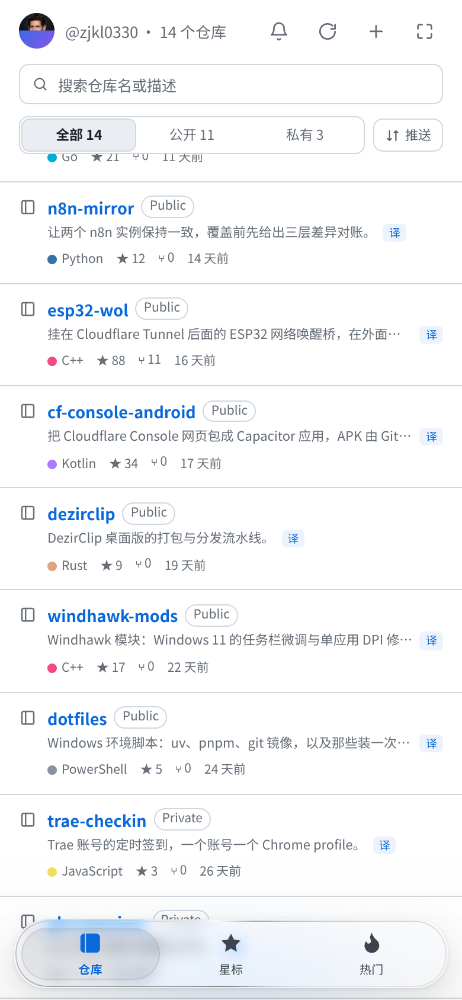
</p>

<p align="center"><sub>浅色主题，滚到列表中段：底栏底下那行简介被糊成色团，一个字都读不出来</sub></p>

代价写在样式里：底栏脱离文档流，`.app.with-tabs > .page` 必须补 `padding-bottom`，否则最后一行永远压在胶囊下面。

账号相关的东西收进个人页：**点左上角头像**进入「我的」，里面有令牌保险库、设置、审计日志、检查更新与锁定。原来底栏的「令牌」「设置」两个格子已经去掉，底栏不再需要挤六个。

设置页从上到下依次是：外观（主题 + 底栏显示）、翻译（目标语言 / 翻译范围 / 通道 / 微软密钥）、账号与网络（令牌入口 + 多账号偏好 + API 地址）、安全、版本与更新（通道 + 检查更新）、本机数据。

流水线是二级页面：从仓库详情的「工作流」进，进入后顶部有返回。工作流详情、运行详情仍是叠在它上面的弹层。

仓库详情里除了可见度、归档、删除，还挂着一排入口：

- **工作流** → 打开该仓库的流水线二级页
- **发行版** → 列出 tag、附件、下载次数，可新建与删除
- **复刻** → 列出全部复刻，可复刻到自己账号
- **项目自述** → 读 README，Markdown 排版，英文可一键机翻
- **下载源码 ZIP** → 下默认分支压缩包，文件名与 GitHub 一致（`仓库-分支.zip`）
- **仓库主页** → 站内打开代码浏览 / Issues / PR / 设置（v1.1.0 起不再踢去系统浏览器）
- **复制仓库地址** → 复制 `https://github.com/owner/repo`，要网页版自己粘出去

### 为什么下个 zip 要绕这么多

GitHub 的 `/archive/refs/heads/<branch>.zip` 不产出字节，它只回一个 302，真正的 zip 在 `codeload.github.com` 上。国内直连 codeload 基本不通，所以：

- 自建反代是「透明路径代理」，302 原样交给浏览器，浏览器接着去连 codeload → 转圈到超时；
- `gh-proxy` 这类 url 型反代能把 codeload 整段代理掉（`{base}/https://codeload.github.com/...`），这条最稳。

实测（2026-11）能吃 codeload 的公共反代不多，多数直接 403 或 404，所以候选顺序是「当前镜像代理 codeload → 用户填的反代 → 当前镜像 archive → 官方 codeload」，**逐条 HEAD 探活**再交给浏览器 —— 不探的话用户看到的是「点了没反应」或者一个 0 字节文件。四条上限：探活是一条条等的，再多就等到以为死机。

Web 端不做探活（HEAD 基本被 CORS 挡住，探了反而误判成全不通），直接开第一条。

<p align="center">
  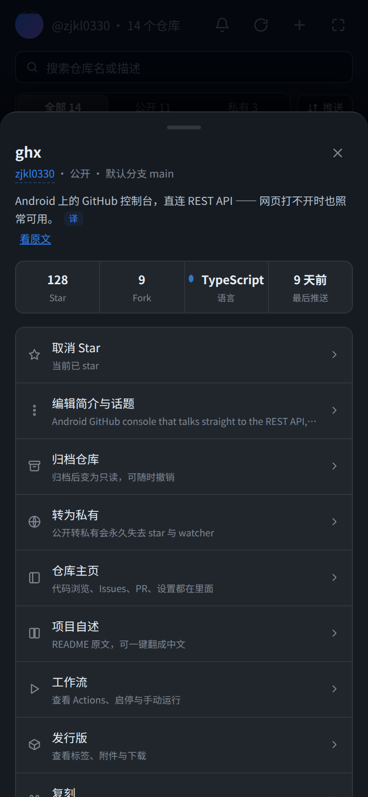
  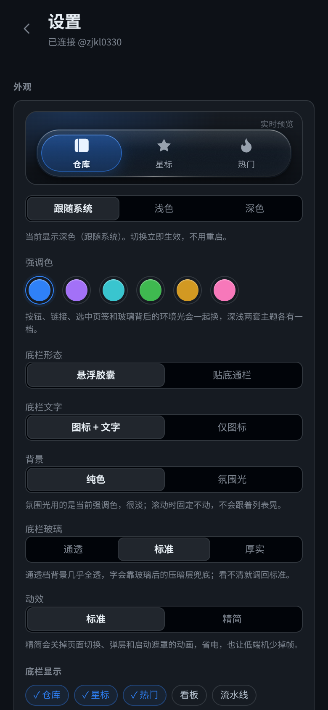
</p>

<p align="center"><sub>左：仓库详情（简介译文 + 「看原文」）· 右：设置里的翻译通道</sub></p>

### 用户主页

从仓库详情点 owner、从 Issue / PR 点作者，或者在全局搜索里选「用户」，都能进到主页。关注者与正在关注点开就是列表；仓库能按最近推送 / 星标 / 名称重排，也能只看自己写的仓库。

<p align="center">
  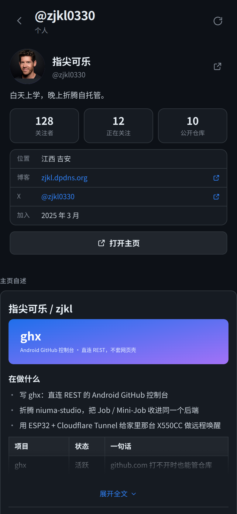
</p>

### 主页自述

GitHub 的个人主页 README，其实就是 `{login}/{login}` 这个同名仓库里的 README。App 直接把它铺在资料下方，不用再点一次。

- 标题（包括 `<h1 align="center">` 这种 HTML 写法）、列表、表格、代码块、图片都渲染
- 图片优先走加速前缀，加载失败或超时自动换回 raw 原图
- 超过 300px 收成「展开全文」，不把仓库列表顶到屏幕外
- 自己的账号多一个「编辑」，带内容 `sha` 做乐观锁 —— 不带的话 GitHub 会把「更新」当「新建」，回 422
- 没有自述时告诉你怎么办：建一个和用户名同名的仓库就行

### 数据看板

底栏「看板」，或从「我的 → 数据看板」进（会自动把页签放进底栏）。

<p align="center">
  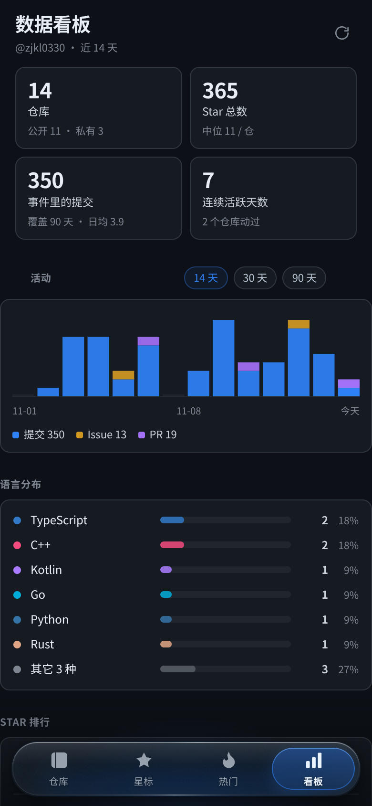
  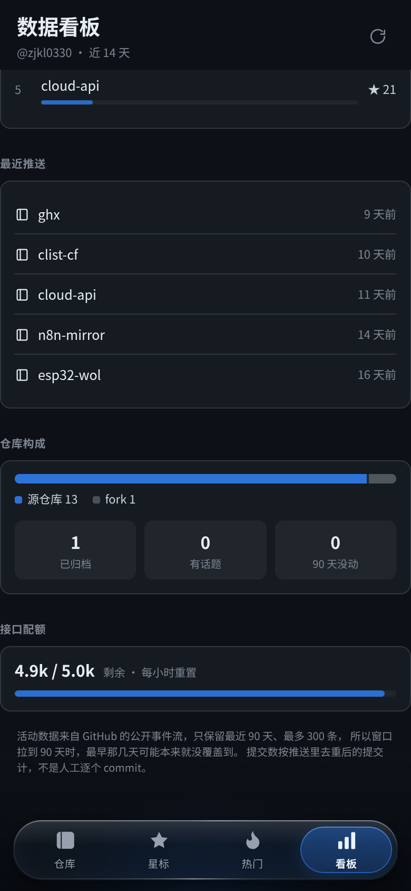
</p>

- **四个指标**：仓库数、Star 总量、事件流里的提交数、连续活跃天数
- **活动柱状图**：提交 / Issue / PR 三色堆叠，14 / 30 / 90 天可切
- **语言分布**按仓库数排，不按 star 加权 —— 一个爆款仓库不该让整页看起来像「我主要写 Rust」
- Star 排行与最近推送都能直接点进仓库
- **仓库构成**：源仓库 / fork / 归档 / 有话题 / 90 天没动
- 底部一条接口配额，扣得快的时候一眼能看见

口径写在页面最下方：数据来自公开事件流，只保留 90 天、最多 300 条；提交数按推送里去重后的提交计，不是人工逐个 commit。

### 外观

颜色、底栏、背景、玻璃厚度和动效都在「设置 → 外观」里，改完立刻生效，重开也还在。强调色会把按钮、链接、选中页签和玻璃背后的环境光一起换掉。

<p align="center">
  
  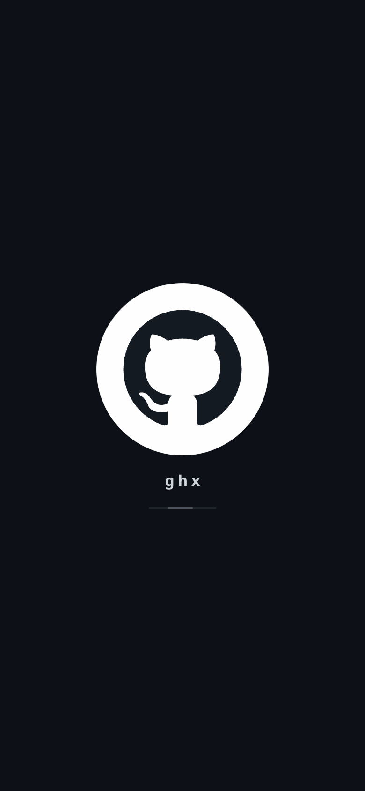
</p>

### 多账号

一个 PAT 对应一个 GitHub 账号，保险库可以同时放多个。

- **入口**：顶栏 `@账号名` 右侧的箭头，或「我的」顶部账号卡片；两处都打开同一个面板
- **切换时**：先存下当前账号的现场，再恢复目标账号的现场（路由栈、列表、搜索词、筛选、排序、未读、置顶）；现场同时落盘，关掉 App 再开也还在。v1.1.1 起可在设置 → 账号与网络 → 多账号里关掉「切回账号时接着上次看」，关掉后每次切换都回首页
- **删号**：顺手清掉该账号的现场与客户端实例，别的账号不受影响
- **新增账号**：已有账号在用时不抢占会话，只在后台把 `@login` 补上；第一个账号才自动激活
- **缓存隔离**：每个 `GitHubClient` 自带一份响应缓存，切账号就是换实例，天然不串
- **审计**：每次切换记一条「切换账号」，带着 `@login`
- **批量动作默认勾几个**：Star / 复刻面板按设置里的偏好预勾（全部 / 1 / 2 / 3），当前账号固定排第一；跳过「已 star / 已有复刻」的账号不占名额

### 多设备

一套布局吃三种宽度，不写第二套 UI：

| 宽度 | 行为 |
|---|---|
| ≤ 639px | 满宽，手机默认形态 |
| ≥ 640px | 内容 620px 居中，平板不再把列表拉成横幅 |
| ≥ 1024px | 760px 居中，横屏平板与桌面预览用 |
| 横屏（任意高度） | 铺满，不再居中 —— 横屏再留边就是两条白带 |

弹层跟随同一宽度居中；上下左右都吃 `safe-area-inset`；横屏一律铺满（不限高度，平板横屏也不留边），底栏收窄到 460px 居中；高度不足 620px 时再压到 46px、圆角收小。**锁定双指缩放**：整页放大后底栏的模糊采样跟着放大，正文会从玻璃里透出来；想放大字号请用系统的「字体大小」，WebView 的 `textZoom` 照常跟随。

<p align="center">
  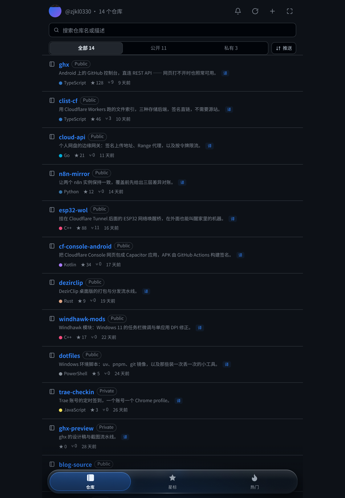
  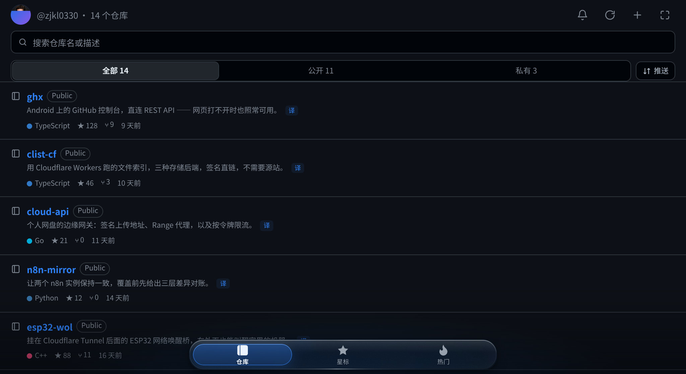
</p>

<p align="center"><sub>左：平板 820×1180 按列居中 · 右：横屏 1024×560 铺满，两侧不留白 —— 底栏在平板上跟着收窄，横屏反过来收到 460px，不拉成一根横杠</sub></p>

## 返回键

安卓的返回键一按就退 App，是因为没人接管，系统直接 `finish()` 掉 Activity。ghx 把返回做成逐层退出：

| 当前状态 | 按返回 |
|---|---|
| 软键盘弹着 | 先收键盘 |
| 口令面板 | 关面板，留在设置页 |
| 发行版 / 复刻 / 项目自述 | 回仓库详情，而不是整屏收起 |
| 运行详情 | 回工作流详情（从流水线直接进来的则收起） |
| 运行日志 | 回运行详情 |
| 提交详情 | 回提交历史，再退一层回文件 |
| 任意弹层 | 关掉最上面一层 |
| 二级页面（个人页 / 设置 / 令牌 / 审计 / 流水线） | 退回上一层：设置回个人页，个人页回主界面 |
| 批量多选 | 退出多选，保留筛选条件 |
| 非首页页签 | 回底栏第一项 |
| 仓库页 | 第一次提示「再按一次返回退出」，2 秒内再按才退 |

批量改可见度正在执行时返回会被拦下，和界面上禁用取消按钮保持一致，避免任务跑到一半看不见结果。

## 缓存

切页签、退弹层再进，默认不再重新打网络。缓存按数据类型分档，改完自动失效：

| 数据 | 缓存时长 | 为什么 |
|---|---|---|
| 搜索结果（热门） | 5 分钟 | 搜索接口配额最贵（认证后 30 次/分钟）|
| 星标 / 仓库列表 | 60 秒 | 变化不频繁，切页签够用 |
| 运行列表 | 15 秒 | 状态变化快 |
| 作业与步骤 | 20 秒 | 同上 |
| 发行版 / 复刻 | 2 分钟 | 基本静态 |

内存缓存随进程消失，所以另有一层落到本机的快照：

- **仓库列表**：冷启动先渲染上次的数据，同时后台刷新，界面不再空转。快照带令牌 id，换号不会串数据，超过 7 天自动作废。
- **热门榜单**：按「时间段 + 语言」各存一份，上限 9 份、超过 3 天作废，写入前剔除私有 / 停用仓库与权限位。十分钟内命中就不打网络，超过十分钟也是先渲染再静默刷新；另外两个时间段会在空闲时预取，点过去基本即时。

## 自述阅读

打开 README 时按这个顺序取内容：

1. **仓库自带中文版** —— README 顶部有「English | 简体中文」这类语言切换（文字链接、图片按钮都认），或者目录里存在 `README.zh-CN.md` / `README.zh.md` / `README_CN.md` 这类命名，直接显示作者自己的译文，不机翻、不消耗额度。
2. **原文就是中文** —— 直接显示。
3. **机翻** —— 只有前两条都不成立才翻，设置 → 阅读里可整体关掉。

图片与徽章按原样渲染：相对路径会按 README 所在目录解析到 `raw.githubusercontent.com`，``、`<picture>`、`` 都支持；同一行的多张图（语言按钮、徽章墙）并排排布，不各占一行。

图片在填了加速站之后走加速站（路径风格为 `{前缀}/{owner}/{repo}/raw/{branch}/{path}`，完整地址风格为 `{前缀}/https://raw.githubusercontent.com/...`），失败或 12 秒无响应再回退直连，两边都不通才显示「图片没能加载」占位。国内直连 raw 域名经常连不上，`` 在等待时又不触发错误回调，不设超时就是一块永远空白的区域。

翻译走免费通道，没有自己的后端：

| 通道 | 情况 |
|---|---|
| Edge（默认首选） | 微软 Edge 浏览器自带的翻译接口，**免密钥、不用注册**，国内实测可直连；单次能吞 5 万字符，整篇 README 一两次请求就能翻完，简介还能 40 条一批。它不是公开 API，微软随时可能关掉，所以只作默认、不作唯一：关掉了自动降级到下面几条 |
| 微软（Azure Translator） | 官方接口最稳。需要自己在 Azure 建一个「翻译」资源（免费 F0 档每月 200 万字符），把密钥填进设置；单次 4 千字节，简介可 25 条一批 |
| MyMemory | 不用密钥，国内可达，但单段 450 字节，撞 429 会退让重试；免费额度有限，适合偶尔翻一两篇 |
| Google | 质量不错，国内常连不上，只作备选 |

「自动」模式的顺序是 **Edge → 微软（填了密钥）→ MyMemory → Google**，前一条失败才走下一条，不会因为一家挂掉就整篇留在英文。

> 2026-07-30 微软关掉了老的 `edge.microsoft.com/translate/auth` 取 token 接口（现在固定 404），App 已改用新的 `translatetext` 端点。这类免费接口没有 SLA，所以设置里随时可以手动切通道。

**译文语言**可选简体中文 / 繁體中文 / English / 日本語 / 한국어，选择记在本机。

**翻译范围**在设置里分开控制：项目自述、仓库简介。自述打开时自动翻、边翻边显示；简介只翻当前列表可见的前 30 条（批量通道一次 30 条、逐条通道压到 12 条）与正在看的详情，命中缓存后不再请求。仓库 / 星标 / 热门三个列表共用这条规则，取数逻辑只有 `pickDescItems()` 一处。

原文按段落切分，一次最多翻 40 段、并发 6（MyMemory 这类要限流的通道降到 20 段、并发 3），翻好一段就替换一段。长 README 翻完一批可点「继续翻译剩余 N 段」。

**链接与格式不经过翻译通道**（v1.1.1 起）：一段文字按行内结构拆成「可翻片段」，链接地址、顺序、数量由本机保存，只把文字片段逐条送翻，回来按原顺序拼回。通道即使把占位符吞掉、把 emoji 啃成 ◆◆，也顶不掉链接；某个片段译文异常（缺段、出现替换字符、emoji 变少）时整段保留原文，绝不写半截译文。纯地址标签、emoji 与已经是中文的片段直接不送翻，省一次请求也避免被改写。

两处历史 bug 已修：

- **长段落整块发出去被 MyMemory 拒绝**，超过 450 字节的引用块、长段落一直显示英文。现在块内先按通道上限切分，逐段翻完再按原顺序拼回，单段失败只留那一段原文。
- **中英混排被误判成「已是中文」**：旧逻辑按中文占比 15% 就跳过，一句中文夹一串英文术语就会漏。现在改成 `needsTranslation()`，按非目标语言字符占比判断。

代码块不送翻。译文按「通道 + 目标语言 + 内容哈希」存在本机，同一份内容只消耗一次额度。

写操作（改可见度、star、触发工作流、发版）成功后，只清掉受影响的那部分缓存。刷新按钮与后台轮询一律绕过缓存，避免「点了刷新还是旧数据」。

## 权限要求

| 功能 | 需要的 scope |
|---|---|
| 读仓库 / 改可见度 / 归档 | `repo`（私有仓库）或 `public_repo` |
| 工作流启停、手动触发、取消与重跑 | `workflow` |
| 删除仓库 | `delete_repo` |
| 新建 / 删除发行版 | `repo` |

缺 scope 时 App 会直接显示「权限不足：该令牌没有执行此操作的 scope」，不会静默失败。手动触发还要求工作流自身声明了 `workflow_dispatch`，否则 GitHub 返回 422，App 会说明原因。

## 安装

从 [Releases](https://github.com/zjkl0330/ghx/releases) 下载 `ghx-<版本>-debug.apk` 直接安装。要求 Android 6.0+（minSdk 23）。

打开即用，不设口令、不弹解锁页。要加锁的话去「设置 → 安全 → 开启启动验证」，口令至少 8 位，忘了无法找回。

## 检查更新怎么走

两条通道刻意分开：

- **查版本** → `api.github.com/repos/zjkl0330/ghx/releases/latest`，匿名请求，不带你的令牌
- **下安装包** → 你自己填的加速站；没填就是 github.com 直连（国内基本不通，所以面板会提示去加一条）

v1.1.3 起**包里不再预置任何加速站**：候选只有官方直连，加什么站由你自己决定。进「设置 → 下载加速」会逐个测速：每个站只拉前 256 KB，按实际吞吐排名，**默认自动选最快的一台**并用于安装包与自述图片。测速结果缓存 6 小时，冷启动不会重测；换了网络想重测，点一下「重新测速」即可。

**加速站域名会换，所以每个站点都能改地址。** 列表里点站点右侧的铅笔，直接改前缀，保存后立即全局生效 —— 自述图片、安装包下载、发行版页面用的是同一份站点表，不用等新版本。新装是空表，点「添加自己的站点」，填地址、选路径风格、勾选是否代理网页，加进来就能一起测速。

代理有两种路径风格，填错会 404，App 里按站点类型自动拼：

| 风格 | 拼出来的下载地址 |
| --- | --- |
| 路径 | `{前缀}/{owner}/{repo}/releases/download/{tag}/{文件}` |
| 完整地址 | `{前缀}/https://github.com/{owner}/{repo}/releases/download/{tag}/{文件}` |

更新页还有「打开发行版页面」：查不到更新、或安装包没上传完时，可以直接在浏览器里看说明、手动下载。纯下载型代理不代理 HTML，这类站点上该按钮会退回到你能翻页的站（没有就用 github.com），不会点出一片 403。

更新时用系统浏览器下载，装完覆盖安装，本地令牌与审计日志不会丢。

## 本地构建

```bash
pnpm install
pnpm test                 # 1462 项单元测试
pnpm build                # 类型检查 + 打包
pnpm cap:sync             # 同步版本号到 gradle 并 cap sync

cd android && ./gradlew assembleDebug
```

产物在 `android/app/build/outputs/apk/debug/app-debug.apk`。

需要 JDK 21（Capacitor 7 的硬要求）与 Android SDK 35。

版本号只在 `package.json` 维护一处，`scripts/sync-version.mjs` 会把它同步成 gradle 的 `versionName` 与 `versionCode`（`major*10000 + minor*100 + patch`）。

CI 在 `.github/workflows/build-apk.yml`：push 到 main 出 artifact，打 `v*` tag 自动发 Release 并附 APK。

## 版本与发布

每改一次就推进一个补丁位，补丁位满 10 进次版本，每次推进都直接发 Release：

| 当前 | 下一次 | 说明 |
|---|---|---|
| 0.4.0 | 0.4.1 | 补丁位 +1 |
| 0.4.8 | 0.4.9 | 补丁位到 9 |
| 0.4.9 | 0.5.0 | 补丁位满 10，进位归零 |
| 0.9.9 | 1.0.0 | 次版本同样满 10 进主版本 |

```bash
pnpm version:bump                                   # +0.0.1，同时同步 gradle
pnpm test && pnpm build
git add -A && git commit -m "feat: ..."
git tag -a "v$(node -p "require('./package.json').version")" -m "ghx $(node -p "require('./package.json').version")"
git push origin main --tags
```

tag 一推，CI 自动构建 APK、校验签名指纹（不匹配直接失败）、生成 Release 并附安装包。

默认发出来的是**预发布**（Pre-release）：不占用 `/releases/latest`，正式通道的用户收不到提示。要发**正式版**，在 tag 注解里加一行 `<!-- release: stable -->`（HTML 注释，页面上看不见），CI 会取消 Pre-release 勾选并把 `latest` 指过去：

```bash
git tag -a v1.1.0 -F notes.txt   # notes.txt 里含 <!-- release: stable -->
git push origin v1.1.0
```

客户端「更新通道」选正式版时查 `/releases/latest`，选测试版时查 `/releases` 列表并按版本号取最高（同号正式版优先于预发布）。

## 解锁方式与安全边界

密钥和口令是两件事，ghx 把它们拆开了：

| 模式 | 启动体验 | 适用 |
|---|---|---|
| 免密（默认） | 打开直接进主界面 | 一个人用的手机 |
| 启动验证（可选） | 每次启动输口令 | 手机可能被别人拿去 |

两种模式令牌都是 AES-256-GCM 密文落盘。区别只在设备密钥放在哪：免密时它也留在本机，所以能防住「数据文件被单独拷走或上传」，防不住拿到已解锁手机的人；开启启动验证后，设备密钥被口令包裹，才真正需要口令才能解开。

- 旧版本（口令派生密钥）的保险库会在解锁屏或设置页提供一次性迁移，令牌解密后重新加密，原文不变
- 口令只在本机参与解密，不上传、不保存，也没有找回途径
- 没有后端、没有遥测、没有账号体系，所有请求从手机直发你配置的 API 地址
- 手动「锁定保险库」会清空内存中的密钥与明文；免密模式下再点一下就回来，只起遮挡作用
- 审计日志只存本机，可一键清空
- 仓库 URL 一律用 `owner/name` 拼接，不做文件系统操作

## 项目守则

历次需求与踩坑记录整理在 [RULES.md](./RULES.md)：交付形态、界面基调、令牌与解锁、返回键层级、缓存策略、版本与发布流程、验证标准、已知边界。改动前先读。

接手写代码（人或 AI）先读 [AGENTS.md](./AGENTS.md)：目录地图、七个核心机制、硬约束、踩过的坑、发布流程。**读完这一份不用再通读源码**。

换机器 / 换模型、要从零把环境跑起来，看 [docs/HANDOVER.md](./docs/HANDOVER.md)：工具链版本、签名恢复、验收闸门的真实数字、发版与推送、以及 v1.1.5→v1.2.0 那一串坑的根因。

只想扫一眼要守什么，看 [docs/RULES-SUMMARY.md](./docs/RULES-SUMMARY.md)：十条红线 + 交付/界面/缓存/翻译/发布/验证的执行清单。改界面之前看 [docs/STYLE.md](./docs/STYLE.md)：配色变量、字号阶梯、圆角间距、液态玻璃参数与反模式。
接下来要做什么、哪些功能做不了、为什么，见 [ROADMAP.md](./ROADMAP.md)：按 Issues / PR / 代码浏览 / 分支 / Actions / 通知 / 搜索分批，每项都标了 REST 端点、所需 scope、复杂度和坑。

## 许可

MIT
